GEOMETOR • feuerbach
====================

**Visit the Online Archive:** https://geometor.github.io/feuerbach/

**Karl Wilhelm Feuerbach • Eigenschaften einiger merkwürdigen Punkte des geradlinigen Dreiecks • semantic digital archive**

Mission
-------

``geometor/feuerbach`` is part of the interconnected `GEOMETOR <https://geometor.com>`_ semantic digital archive. It liberates Karl Wilhelm Feuerbach's revolutionary 1822 monograph *Eigenschaften einiger merkwürdigen Punkte des geradlinigen Dreiecks* from isolated print bounds into addressable semantic units, synchronized reading tracks, calibrated theme-adaptive vector diagrams, primary-source folio provenance, and exact symbolic algebra across the GEOMETOR corpus.

Books in This Archive
---------------------

- **`Properties of Remarkable Points of the Rectilinear Triangle <https://geometor.github.io/feuerbach/feuerbach_1822/>`_** — Eigenschaften einiger merkwürdigen Punkte des geradlinigen Dreiecks (1822) featuring the discovery and proof of the nine-point circle and its internal tangency to the incircle at the Feuerbach point :math:`X(11)`.

Repository Contents
-------------------

- ``docsrc/`` — Four-track Book Codex, apparatus registries, and Sphinx docs compiled by `PHOTON publish <https://github.com/photon-platform/publish>`_.
- ``resources/`` — Primary folio scans, structure maps, persons/citations registries, and review manifests.
- ``src/geometor/feuerbach/`` — Exact symbolic geometry models, algebraic tangency audits, and demonstration pipelines.

Local Build & Verification
--------------------------

.. code-block:: bash

   publish build
   uv run --no-sync pytest

Part of the GEOMETOR Knowledge Archive
--------------------------------------

Explore all **74 Book Codices** and **11 Mathematical Catalogs** at https://geometor.com/books/.
