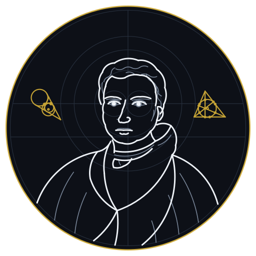

.. container:: author-overline

   semantic digital archive • the works of

======================
Karl Wilhelm Feuerbach
======================

**Karl Wilhelm Feuerbach** (1800–1834), writing at twenty-two in Nuremberg, unveiled one of the crown jewels of triangle geometry: the nine-point circle passing through the feet of a triangle's altitudes and the midpoints of its sides simultaneously kisses all four tritangent circles—touching the incircle internally at the Feuerbach point :math:`X(11)` and each of the three excircles externally.

Books in This Collection
------------------------

.. container:: home-book-hero

   .. container:: home-book-thumb

      .. image:: _static/constructions/feuerbach_tangency.svg
         :alt: Feuerbach's Theorem (1822, § 57): Nine-Point Circle tangent to incircle and three excircles
         :target: feuerbach_1822/index.html

   .. container:: home-book-body

      .. rubric:: Nuremberg Edition · 1822 · 7 Units · 4 Synchronized Tracks

      **Properties of Remarkable Points of the Rectilinear Triangle** (*Eigenschaften einiger merkwürdigen Punkte des geradlinigen Dreiecks*) — Complete folio-verified edition across Buzengeiger's Preface, Sections I–V (§§ 1–87), and the 9-proposition Synthetic Appendix in **English · German · Summary · Notes** tracks.

      .. container:: home-actions

         * :doc:`Open Feuerbach (1822) → <feuerbach_1822/index>`
         * :doc:`Section IV (Nine-Point Circle & § 57) → <feuerbach_1822/abschnitt_4/index>`
         * :doc:`Synthetic Appendix → <feuerbach_1822/anhang/index>`
         * :doc:`Symbolic Demos → <demos/index>`

Key Features
------------

.. container:: home-feature-grid

   .. container:: home-feature-card

      **The Nine-Point Circle & Fourfold Tangency**

      Trace Feuerbach's § 57 algebraic derivation of :math:`LS = \tfrac{1}{2}R - r` and :math:`LS^{(k)} = \tfrac{1}{2}R + r^{(k)}` alongside his pure Euclidean *9. Satz* in the Synthetic Appendix.

   .. container:: home-feature-card

      **Bilingual German–English Scriptorium**

      Compare the original 1822 Nuremberg German edition against an original English translation, executive summaries, and historical notes linking Euler (1765) and Fagnano.

   .. container:: home-feature-card

      **Exact Heronian ``(15, 13, 14)`` Verification**

      Verify 30 polynomial identities, the harmonic Euler range :math:`(O, G; L, K) = -1`, and exact rational tangency coordinates :math:`X(11) = (6, 8)` in :doc:`demos/index`.

Reference & Project
-------------------

.. container:: home-columns

   .. container:: home-col

      .. rubric:: Scholarly Apparatus

      * :doc:`People <people/index>` — Biographical profiles of Karl Wilhelm Feuerbach, Karl Buzengeiger, Leonhard Euler, and John Casey
      * :doc:`Bibliography <bibliography>` — 1822 Nuremberg first edition and primary sources
      * :doc:`Concordance <concordance>` & :doc:`Glossary <glossary>` — Cross-corpus mapping to Euler, Casey, and ETC triangle centers

   .. container:: home-col

      .. rubric:: About This Project

      * :doc:`About <about/index>` — Editorial methodology, symbolic grounding, and provenance
      * :doc:`Using This Edition <usage/index>` — Multi-track switching and interactive diagram guide
      * :doc:`Log <log/index>` & :doc:`Modules <modules/index>` — Development journal and Python API reference

.. toctree::
   :maxdepth: 2
   :hidden:

   feuerbach_1822/index
   people/index
   bibliography
   glossary
   concordance
   about/index
   usage/index
   demos/index
   log/index
   modules/index
